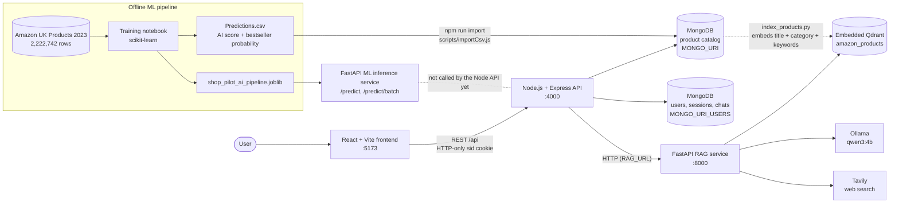
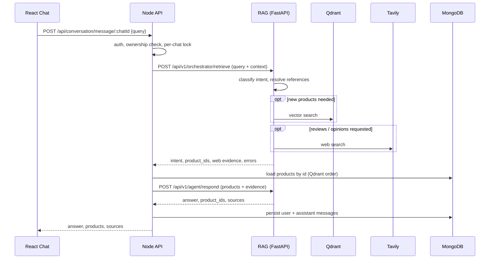
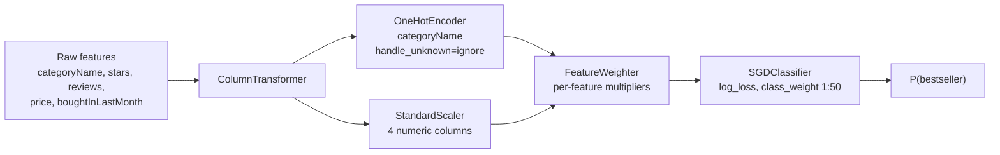

<div align="center">

# ShopPilot AI
---

## Table of Contents

1. [Overview](#overview)
2. [Problem Statement](#problem-statement)
3. [Key Features](#key-features)
4. [System Architecture](#system-architecture)
5. [Technology Stack](#technology-stack)
6. [Machine Learning Pipeline](#machine-learning-pipeline)
7. [Product Ranking and Recommendation Methodology](#product-ranking-and-recommendation-methodology)
8. [Dataset and Data Processing](#dataset-and-data-processing)
9. [Backend Architecture](#backend-architecture)
10. [API Documentation](#api-documentation)
11. [Project Directory Structure](#project-directory-structure)
12. [Installation and Setup](#installation-and-setup)
13. [Environment Variables](#environment-variables)
14. [Running the Application](#running-the-application)
15. [Example Usage](#example-usage)
16. [Current Development Status](#current-development-status)
17. [Future Enhancements](#future-enhancements)
18. [Contributors and Team](#contributors-and-team)
19. [Acknowledgements](#acknowledgements)
20. [License](#license)

---

## Overview

ShopPilot AI is a full-stack product discovery platform built around three ideas:

1. **A product score a shopper can compare at a glance.** Every product gets an *AI Product Score* (0–100) and a *bestseller probability* produced by a scikit-learn pipeline trained on roughly 2.2 million Amazon UK product records.
2. **Semantic retrieval instead of keyword matching alone.** Product text is embedded with `all-MiniLM-L6-v2` and searched in an embedded Qdrant store.
3. **A conversational assistant grounded in catalog data.** A multi-agent FastAPI service classifies the user's intent, retrieves products, optionally gathers web evidence through Tavily, and generates answers with a local LLM served by Ollama.

The system is split into four independently runnable services: a React frontend, a Node.js/Express API, a FastAPI ML inference service, and a FastAPI RAG service.

> **Read this first:** some components live on different Git branches and are not yet merged. See [Current Development Status](#current-development-status) for exactly what is implemented, where it lives, and what is still planned.

## Problem Statement

Large marketplaces return thousands of listings per query. Ratings, review counts, price, and recent sales all matter, but they point in different directions: a 5.0-star product with two reviews is not comparable to a 4.5-star product with 20,000. Shoppers are left to weigh these signals by hand, and keyword search does not help with open-ended questions such as "what should I buy for X under Y?".

ShopPilot AI addresses this by:

- condensing rating, popularity, review volume, and price into a single comparable score;
- estimating bestseller likelihood with a trained classifier;
- retrieving products semantically and letting users ask follow-up questions in natural language;
- keeping answers tied to catalog records and cited web sources rather than free-form generation.

## Key Features

| Feature | Description | Status |
|---|---|---|
| Product catalog | Browse main categories and subcategories, paginated listings, product detail pages | Implemented |
| Search and sorting | Prefix keyword search; sort by rating, popularity, price, or AI score | Implemented |
| AI Product Score | 0–100 score shown on product cards/detail pages, sortable, and used to rank categories on the home page | Implemented (precomputed scores) |
| ML inference API | FastAPI service exposing the trained pipeline for single and batch prediction | Implemented (`Ml_AI_Score` branch) |
| Authentication | Email/password registration and login, Google sign-in, cookie-based sessions stored in MongoDB | Implemented |
| Conversational assistant | Intent classification, Qdrant retrieval, optional Tavily research, LLM answers, conversation memory with rolling summaries; works for guests and signed-in users | Implemented (`devin/rag-chat-orchestration` branch) |
| Product verdict | BUY / WAIT / AVOID verdict synthesised from web review excerpts | Implemented (`devin/rag-chat-orchestration` branch) |
| Live ML scoring from the Node API | Backend calls the ML service at request time | **Not implemented** (scores are imported in batch) |
| Personalized recommendations | Per-user ranking from behaviour history | **Not implemented** |
| Payments / checkout | | **Not implemented** |

## System Architecture

ShopPilot AI is a set of cooperating services. The browser only ever talks to the Node API; the Node API talks to MongoDB and to the RAG service.



### Data flow

- **Browsing and search:** React → Express → MongoDB (`products`, `categories`). Sorting, pagination, and filtering happen server-side.
- **AI scores:** scores are computed **offline** by the ML pipeline, written to a CSV, and **imported into MongoDB** (`aiProductScore`, `bestsellerProbabilityPercent`, `predictedBestseller`, `predictionLabel`). The Express API serves them as ordinary product fields.
- **ML inference service:** a standalone FastAPI app that loads the same trained artifact and scores new products on demand. The Node API does not call it yet.
- **Chat:** React → Express → RAG service (retrieve) → MongoDB enrichment → RAG service (respond) → persist messages. Details below.



## Technology Stack

| Layer | Technologies (as used in the repository) |
|---|---|
| Frontend | React 19, TypeScript, Vite, React Router 7, Tailwind CSS 3, React Icons |
| API | Node.js (ES modules), Express 5, Mongoose, express-rate-limit, bcryptjs, google-auth-library, cookie-parser, csv-parse |
| Database | MongoDB (separate connections for catalog and for users/chats) |
| ML | Python, scikit-learn 1.6.1 (`SGDClassifier`, `ColumnTransformer`, `Pipeline`), pandas, NumPy, SciPy, joblib |
| ML serving | FastAPI, Uvicorn, Pydantic v2, pytest |
| RAG / agents | FastAPI, LangChain, `langchain-ollama`, Ollama (default model `qwen3:4b`), Tavily |
| Embeddings / vectors | `sentence-transformers/all-MiniLM-L6-v2` (384-d), embedded Qdrant (cosine) |
| Testing | pytest (ML, RAG), Node's built-in test runner (backend) |

## Machine Learning Pipeline

The ML work lives in [`ML/`](ML/) (branch `Ml_AI_Score`). The training code is in the notebook `ML/product-ai-score-prediction.ipynb`; serving code is in `ML/app/`.

### What the model actually does

The pipeline is a **binary classifier** that estimates whether a product is flagged as a bestseller in the source data (`isBestSeller`). It is **not** a learned ranker or regressor. Two outputs are produced per product:

| Output | How it is produced |
|---|---|
| `bestseller_probability_percent` | Positive-class probability from the trained classifier, expressed as a percentage. Not guaranteed to be calibrated. |
| `ai_product_score` (0–100) | A deterministic, weighted heuristic over rating, popularity, review volume, and affordability. See [Methodology](#product-ranking-and-recommendation-methodology). |

### Pipeline architecture



| Step | Detail |
|---|---|
| Features | `categoryName`, `stars`, `reviews`, `price`, `boughtInLastMonth` |
| Encoding / scaling | One-hot for category (unseen categories ignored); standard scaling for numeric features |
| Feature weighting | Custom `FeatureWeighter` multiplies columns: stars 6.0, reviews 4.5, price 1.0, boughtInLastMonth 7.0, category 1.0 |
| Classifier | `SGDClassifier(loss="log_loss", alpha=1e-4, class_weight={0: 1, 1: 50})` |
| Training | Incremental `partial_fit` over 30,000-row batches (the full dataset is too large to fit in one pass comfortably) |
| Split | 80/20 random split, `random_state=42` (1,778,193 train / 444,549 test); not stratified |
| Decision threshold | 0.5, stored in the artifact |

### Held-out test results (from the notebook)

The positive class is extremely rare (6,018 of 2,222,742 rows, about 0.27%), so accuracy alone is misleading. Metrics on the 20% held-out split (1,191 positives):

| Metric | Value |
|---|---|
| Accuracy | 0.973 |
| Precision (bestseller) | 0.05 |
| Recall (bestseller) | 0.52 |
| F1 (bestseller) | 0.09 |
| ROC-AUC | 0.767 |
| Average precision | 0.031 (positive-class base rate is about 0.003) |

<details>
<summary><b>How to read these numbers</b></summary>

The class weights deliberately trade precision for recall: the model flags about half of true bestsellers but also flags many non-bestsellers (11,468 false positives vs. 624 true positives on the test split). It is best understood as a coarse "looks like a bestseller" signal built from five features, not a high-precision bestseller detector. The notebook also contains a full-dataset evaluation, but that includes training rows, so it is not reported here. Earlier experiments in the notebook (a batch-grown Random Forest and other SGD variants) are kept for reference; the saved artifact uses the pipeline above.

</details>

### Model serialization and loading

The notebook saves a single `joblib` dictionary, `ML/shop_pilot_ai_pipeline.joblib`, containing the fitted pipeline plus everything needed to reproduce the score:

```
pipeline, product_score_weights, prediction_threshold,
popularity_reference, reviews_reference, price_reference
```

`ML/app/model_service.py` loads and validates this artifact **once at application startup** (FastAPI lifespan) and never retrains or modifies it. Because the artifact was written by scikit-learn 1.6.1 from a notebook, the loader includes a small compatibility shim for the notebook-defined `FeatureWeighter` class and for private symbols that changed in newer scikit-learn releases. For a clean environment, use a Python version supported by scikit-learn 1.6.1.

### How the ML service communicates with the rest of the system

- **Today:** the ML service is a standalone HTTP service (`/predict`, `/predict/batch`). The Express API does **not** call it. Product scores reach the application through the batch CSV import described above.
- **Contract for integration:** a Node client would `POST` the five raw features to `/predict` and read `prediction.ai_product_score` and `prediction.bestseller_probability_percent`. See [API Documentation](#ml-inference-service-fastapi-ml).

## Product Ranking and Recommendation Methodology

Ranking in ShopPilot AI happens in three distinct places. They are separate mechanisms and are described separately here to avoid overstating what each does.

### 1. AI Product Score (0–100)

Computed by `ML/app/scoring.py` (and the equivalent notebook code). Four components, each scaled to 0–100:

| Component | Source feature | Formula |
|---|---|---|
| `rating` | `stars` | `stars / 5 × 100` |
| `popularity` | `boughtInLastMonth` | `log1p(x) / log1p(5000) × 100`, clipped to 0–100 |
| `reviews` | `reviews` | `log1p(x) / log1p(10000) × 100`, clipped to 0–100 |
| `affordability` | `price` | `(1 − price / 50000) × 100`, clipped to 0–100 |

The components are combined with the weights stored in the artifact (`rating 0.40`, `popularity 0.50`, `reviews 0.45`, `affordability 0.15`). Those weights sum to 1.5, and the code **normalizes by the sum of weights used**, so the effective shares are roughly 26.7% / 33.3% / 30.0% / 10.0%. The result is rounded to two decimals and capped at 99.99.

Worked example (matches the live API output in [Example Usage](#example-usage)): stars 4.5, 2,500 reviews, price 45,000, 1,200 bought last month → components 90.0 / 83.3 / 85.0 / 10.0 → **78.24**.

Design notes and caveats:

- Log scaling keeps extremely popular products from dominating.
- The affordability term is a deliberate heuristic ("cheaper scores higher"); it is not learned and does not account for category-specific price norms.
- Reference values (5,000 / 10,000 / 50,000) are fixed constants, which keeps scores comparable across batches but ties them to the dataset's scale and the INR-converted prices used in training.
- The score is **transparent and deterministic**; it is not an output of the classifier.

### 2. Catalog ranking (Node API)

- Product lists can be sorted by `rating` (default), `popular` / `reviews`, `price_asc`, `price_desc`, or `ai` (descending `aiProductScore`).
- `GET /api/categories/ranked` orders categories by the **average AI score** of their products. Categories with fewer than 100 scored products and non-aisle labels are excluded, and each category is shown with its best-scoring product's image. Results are cached in memory for 10 minutes.

### 3. Conversational retrieval (RAG service)

- Product text (`title`, category, subcategory, keywords) is embedded with `all-MiniLM-L6-v2` and indexed in Qdrant using cosine distance.
- For recommendation-style questions the orchestrator returns the top-k nearest products (default 3, capped by `MAX_PRODUCT_TOP_K`, default 10).
- **Retrieval order is vector similarity.** The AI score is stored in the Qdrant payload but is not currently used to re-rank retrieved results.

## Dataset and Data Processing

| Property | Value |
|---|---|
| Source | [Amazon UK Products Dataset 2023](https://www.kaggle.com/datasets/asaniczka/amazon-uk-products-dataset-2023) (Kaggle, `asaniczka`), file `amz_uk_processed_data.csv` |
| Size | 2,222,742 rows × 10 columns, 296 source categories |
| Columns | `asin`, `title`, `imgUrl`, `productURL`, `stars`, `reviews`, `price`, `isBestSeller`, `boughtInLastMonth`, `categoryName` |
| Missing values | None reported for any column |
| Label balance | 6,018 bestsellers vs. 2,216,724 non-bestsellers (about 0.27%) |
| Skew | `Sports & Outdoors` alone has 826,076 rows; many categories have under 100 |
| Raw data in repo | **Not included.** Download it from Kaggle. |

### Preprocessing (training notebook)

1. Load the CSV (2,222,742 rows).
2. Convert price from GBP to INR (`price × 127.43`) and round to whole numbers.
3. Drop `imgUrl`, `productURL`, `title`, and `asin` (not model features).
4. Convert `isBestSeller` to 0/1.
5. Split 80/20 (`random_state=42`).
6. One-hot encode `categoryName`, standard-scale the four numeric features, apply feature multipliers, and train incrementally in 30,000-row batches.

There is no text feature engineering: the model uses five structured features only.

### Catalog import (Node)

`backend/scripts/importCsv.js` streams a `Predictions.csv` into MongoDB with constant memory:

- bulk upserts keyed on `asin` (safe to re-run; never deletes products);
- validates ASINs, titles, and URLs; zero or non-numeric rating/review/price values become `null` rather than being invented;
- first occurrence of a duplicate ASIN wins; skipped rows are written to `import-report.json`;
- maps source category labels onto a main/subcategory tree (`backend/catalog/config/categoryMap.js`) and rebuilds the `categories` collection;
- keeps the real `isBestSeller` flag separate from the model's `predictedBestseller`.

## Backend Architecture

```
backend/
├── index.js                  # Express app, CORS, health check, route mounting, error handler
├── Routes/                   # authRoute.js, chatRoutes.js
├── Controller/               # auth, chat, and message controllers
├── Model/                    # User, Session, Conversation, Message (application DB)
├── catalog/
│   ├── models/               # Product, Category (product DB)
│   ├── routes/               # products.js, categories.js
│   ├── utils/                # query parsing, normalization, category ranking
│   └── config/categoryMap.js # source label -> main/sub category tree
├── services/                 # chatService (turn pipeline), ragClient, productService
├── middleware/, utils/       # auth, origins/CSRF, sessions, validators, db
└── scripts/                  # importCsv.js, checkCategoryMap.js
```

Key design points:

- **Two MongoDB connections.** `MONGO_URI` holds the product catalog; `MONGO_URI_USERS` holds users, sessions, conversations, and messages (falls back to `MONGO_URI` if unset).
- **Server-side sessions.** Login creates a session in MongoDB and sets an HTTP-only `sid` cookie. Passwords are hashed with bcrypt. Google sign-in verifies the ID token server-side.
- **Abuse controls.** Per-IP rate limits on login, registration, Google sign-in, guest chat (30 / 15 min), and product verdicts (10 / 15 min); trusted-origin checks on auth POSTs; JSON body limit of 10 KB.
- **Chat turn orchestration** (`services/chatService.js`): builds context (rolling summary + recent messages + structured product references), calls RAG `retrieve`, enriches product IDs from MongoDB, calls RAG `respond`, then persists both messages in one transaction. A per-conversation lock prevents concurrent turns (409), and an idempotency key makes retries safe. Nothing is saved if any step fails.
- **Conversation memory.** After `SUMMARY_THRESHOLD` (default 10) unsummarized messages, the RAG summarizer condenses them into a running summary, so references like "the second one" keep working.
- **RAG service structure** (`RAG/app/`): `agents/` (orchestrator, product response, review, naming, summarization), `api/v1/endpoints/`, `core/` (config, LLM, embeddings), `schemas/`, `services/product_search.py`. Failures are returned explicitly in an `errors` field rather than silently producing empty results.

## API Documentation

Three services expose HTTP APIs. Only endpoints present in the source code are listed. Interactive docs are available at `/docs` on both FastAPI services.

<a id="ml-inference-service-fastapi-ml"></a>

### ML Inference Service (FastAPI, `ML/`)

Default URL: `http://localhost:8000` (use `--port 8001` when running alongside the RAG service, which also defaults to 8000).

| Method | Endpoint | Purpose |
|---|---|---|
| GET | `/` | Service info |
| GET | `/health` | `200` when the model loaded, otherwise `503` |
| GET | `/model-info` | Safe model metadata (no file paths) |
| POST | `/predict` | Score one product |
| POST | `/predict/batch` | Score 1–100 products (`MAX_BATCH_SIZE`), order preserved |

**Request body** for `/predict` (all fields required): `categoryName` (non-blank string), `stars` (0–5), `reviews` (≥ 0), `price` (≥ 0, same currency units as training data, i.e. INR-scaled), `boughtInLastMonth` (≥ 0). `/predict/batch` takes `{"products": [ ... ]}`.

<details>
<summary><b>POST /predict: example request and response</b></summary>

```bash
curl -X POST http://localhost:8000/predict \
  -H "Content-Type: application/json" \
  -d '{"categoryName":"Electronics","stars":4.5,"reviews":2500,"price":45000,"boughtInLastMonth":1200}'
```

```json
{
  "success": true,
  "product": {
    "categoryName": "Electronics",
    "stars": 4.5,
    "reviews": 2500.0,
    "price": 45000.0,
    "boughtInLastMonth": 1200.0
  },
  "prediction": {
    "ai_product_score": 78.24,
    "bestseller_probability_percent": 100.0,
    "predicted_bestseller": true,
    "prediction_label": "Bestseller",
    "threshold_used": 0.5
  }
}
```

Invalid input (for example `stars: 9`) returns HTTP `422` with a Pydantic validation error. A model-loading or inference failure returns `503` without exposing internals.

</details>

<details>
<summary><b>GET /health and GET /model-info</b></summary>

```json
{ "status": "healthy", "model_loaded": true }
```

```json
{
  "model_name": "ShopPilot AI",
  "model_loaded": true,
  "prediction_threshold": 0.5,
  "input_features": ["categoryName", "stars", "reviews", "price", "boughtInLastMonth"],
  "outputs": ["ai_product_score", "bestseller_probability_percent", "predicted_bestseller"]
}
```

</details>

### Application API (Node/Express, `backend/`, port 4000)

All paths are prefixed with `/api`. Endpoints marked 🔒 require the `sid` session cookie.

| Method | Endpoint | Purpose | Key parameters |
|---|---|---|---|
| GET | `/health` | App and product DB connectivity (`200 ok` / `503 degraded`) | none |
| POST | `/auth/register` | Create an account | `name` (2–50), `email`, `password` (8–72, letter + number), optional `confirmPassword` |
| POST | `/auth/login` | Log in, set session cookie | `email`, `password`, optional `rememberMe` |
| POST | `/auth/google` | Sign in with a Google ID token | `credential` |
| GET | `/auth/me` 🔒 | Current user | none |
| POST | `/auth/logout` | End the session | none |
| GET | `/categories` | Main categories with subcategories (non-empty only) | none |
| GET | `/categories/ranked` | Categories ordered by average AI score | `level=main\|sub`, `limit` (1–30, default 12) |
| GET | `/categories/:slug` | One category | none |
| GET | `/categories/:slug/products` | Products in a category | `page`, `limit`, `sort`, `q` |
| GET | `/products` | List or search products | `search`, `category` (sub slug), `main`, `bestSeller`, `page`, `limit` (≤ 60), `sort` |
| GET | `/products/search` | Keyword search (min. 2 characters) | `q`, `page`, `limit`, `sort` |
| GET | `/products/:asin` | Product detail | ASIN (10 alphanumeric chars) |
| POST | `/products/:asin/verdict` | BUY/WAIT/AVOID verdict via the RAG review agent (rate-limited) | ASIN |
| GET | `/conversation` 🔒 | List the user's conversations (up to 100) | none |
| POST | `/conversation` 🔒 | Create a conversation with its first turn | `query`, optional `clientRequestId` / `Idempotency-Key` |
| GET | `/conversation/:chatId` 🔒 | Conversation and messages | none |
| PUT | `/conversation/:chatId` 🔒 | Rename | `title` (1–80 chars) |
| DELETE | `/conversation/:chatId` 🔒 | Delete conversation and messages | none |
| GET | `/conversation/message/:chatId` 🔒 | Messages of a conversation | none |
| POST | `/conversation/message/:chatId` 🔒 | Send a follow-up turn | `query`, optional idempotency key |
| PUT | `/conversation/message/:messageId` 🔒 | Update a message | see `messageController.js` |
| POST | `/conversation/guest/message` | Non-persisted guest turn (30 req / 15 min) | `query`, `conversation_context` |

Legacy aliases `POST /auth/signup` and `POST /auth/signin` are still routed.

`sort` accepts `rating` (default), `popular`, `reviews`, `price_asc`, `price_desc`, and `ai`.

<details>
<summary><b>Response shape: product listing</b> (<code>GET /api/products?search=...</code>, values are placeholders)</summary>

```json
{
  "query": "<search term>",
  "items": [
    {
      "asin": "<ASIN>",
      "title": "<title>",
      "imgUrl": "<url>",
      "price": 0,
      "stars": 0,
      "reviews": 0,
      "isBestSeller": false,
      "aiProductScore": 0,
      "mainCategory": "<name>", "mainSlug": "<slug>",
      "subcategory": "<name>", "subSlug": "<slug>"
    }
  ],
  "page": 1,
  "limit": 24,
  "total": 0,
  "totalPages": 1
}
```

</details>

<details>
<summary><b>Response shape: conversation turn</b> (<code>POST /api/conversation/message/:chatId</code>, from <code>docs/chat-pipeline.md</code>)</summary>

```json
{
  "success": true,
  "chat": { "_id": "...", "title": "...", "summary": "...", "unsummarizedMessageCount": 2, "productSets": [] },
  "messages": [ { "sender": "User", "message": "..." }, { "sender": "Assistent", "message": "...", "metadata": { } } ],
  "answer": "...",
  "intent": "product_recommendation",
  "products": [ { "productId": "...", "asin": "...", "title": "...", "price": 299 } ],
  "sources": [],
  "summarized": false
}
```

Errors use `{ "success": false, "code": "...", "message": "..." }` with status 400 / 401 / 403 / 404 / 409 (another message in this chat is still processing) / 502 (AI service failed) / 503 (product DB unavailable) / 504 (AI service timed out). A repeated idempotency key returns `200 { "duplicate": true, "messages": [...] }`.

</details>

### RAG Service (FastAPI, `RAG/`, port 8000)

Called by the Node API; it is not intended to be called directly by the browser. Routes are mounted under `/api/v1` (and also at the root).

| Method | Endpoint | Purpose |
|---|---|---|
| GET | `/health` | Service health |
| POST | `/api/v1/orchestrator/retrieve` | Classify intent, resolve product references, run Qdrant / Tavily retrieval |
| POST | `/api/v1/agent/respond` | Generate an answer from supplied products and evidence (no retrieval) |
| POST | `/api/v1/summarization/summarize` | Fold messages into a rolling conversation summary |
| POST | `/api/v1/naming/title` | Generate a conversation title |
| GET | `/api/v1/verdict` | BUY / WAIT / AVOID verdict. Query: `product_id`, `product_name`, optional `debug`, `refresh` |

Request and response contracts are defined in `RAG/app/schemas/` and documented in [`docs/chat-pipeline.md`](docs/chat-pipeline.md).

## Project Directory Structure

> The layout below is the combined structure. `ML/` currently exists only on the `Ml_AI_Score` branch, and the chat/verdict code (`docs/`, `RAG/app/agents/orchestrator`, `backend/services/`, `frontend/src/pages/Chat.tsx`) only on `devin/rag-chat-orchestration`. See [Current Development Status](#current-development-status).

```
shop-pilot-ai/
├── ML/                              # FastAPI ML inference service            (Ml_AI_Score)
│   ├── app/                         # main.py, model_service.py, scoring.py, schemas.py
│   ├── tests/                       # health, predict, validation, real-artifact tests
│   ├── product-ai-score-prediction.ipynb   # data exploration + training
│   ├── shop_pilot_ai_pipeline.joblib        # trained artifact
│   └── requirements.txt
├── RAG/                             # FastAPI multi-agent RAG service
│   ├── app/                         # agents/, api/v1/, core/, schemas/, services/
│   ├── product-vector-index/        # index_products.py, search_products.py (Qdrant)
│   ├── tests/
│   └── requirements.txt
├── backend/                         # Node.js + Express API
│   ├── catalog/, Controller/, Model/, Routes/, services/, middleware/, utils/
│   ├── scripts/                     # importCsv.js, checkCategoryMap.js
│   ├── tests/
│   └── .env.example
├── frontend/                        # React + Vite + TypeScript
│   ├── src/                         # pages/, components/, api/, context/, hooks/, utils/
│   └── .env.example
├── docs/chat-pipeline.md            # chat orchestration design notes
├── Schema.drawio / Schema.png       # early design diagram (PostgreSQL-based plan)
├── services.drawio / service.jpeg   # early microservice design diagram
└── README.md
```

> `Schema.*` and `services.*` are early design artifacts. They describe a PostgreSQL-based microservice plan, whereas the current implementation uses MongoDB and the four services shown in [System Architecture](#system-architecture).
>
> `Assignment_3/`, `CampusEats-*`, `Web_Assignment8_CampusEats/`, `campuseats-assignment-9/`, and the `*.zip` files on `main` are coursework submissions that share this repository. They are unrelated to ShopPilot AI itself.

## Installation and Setup

### Prerequisites

- **Git**
- **Node.js** (a current LTS release; the project uses Express 5, React 19, and Vite) and npm
- **Python 3.11+** (for the ML service, use a version supported by scikit-learn 1.6.1; Python 3.12 was verified, see notes)
- **MongoDB**, local or Atlas. The backend test suite needs a replica set (`MONGO_TEST_URI`).
- **Ollama** with a pulled model, for the RAG service: `ollama pull qwen3:4b`
- A **Tavily API key** for web research and verdicts
- The **Kaggle dataset** and a prepared `Predictions.csv` if you want to populate the catalog (see below)

### 1. Clone

```bash
git clone https://github.com/udaygupta9081/shop-pilot-ai.git
cd shop-pilot-ai
```

Check out the branch(es) containing the components you want. The ML service is on `Ml_AI_Score`; the chat assistant is on `devin/rag-chat-orchestration`.

### 2. Backend (Node/Express)

```bash
cd backend
npm install
cp .env.example .env        # PowerShell: Copy-Item .env.example .env
# edit .env: set MONGO_URI, MONGO_URI_USERS, RAG_URL, CLIENT_ORIGIN, GOOGLE_CLIENT_ID (optional)
```

Populate the catalog (put the file at `backend/data/Predictions.csv`, which is git-ignored, or pass `--file`):

```bash
npm run import:dry          # parse + validate only, writes import-report.json
npm run import              # upsert into MongoDB (safe to re-run)
```

### 3. Frontend (React/Vite)

```bash
cd frontend
npm install
cp .env.example .env
```

### 4. ML inference service (FastAPI)

```bash
cd ML
python -m venv .venv
source .venv/bin/activate   # Windows PowerShell: .\.venv\Scripts\Activate.ps1
pip install -r requirements.txt
```

### 5. RAG service (FastAPI)

```bash
cd RAG
python -m venv .venv
source .venv/bin/activate
pip install -r requirements.txt
# create RAG/.env (see Environment Variables)
```

Build the Qdrant vector index from the products already in MongoDB (run once after importing the catalog; this embeds every product and can take a long time on the full catalog):

```bash
cd RAG/product-vector-index
python index_products.py
```

### Regenerating the model (optional)

Open `ML/product-ai-score-prediction.ipynb` (written for a Kaggle environment, with paths under `/kaggle/input/...`), adjust the dataset path, and run it. The final training cell writes `shop_pilot_ai_pipeline.joblib`. Retraining on the full dataset is memory-intensive, which is why training is done in 30,000-row batches.

## Environment Variables

No credentials are provided in this README. Fill in your own values and never commit `.env` files.

<details>
<summary><b>backend/.env</b> (template: <code>backend/.env.example</code>)</summary>

| Variable | Required | Purpose |
|---|---|---|
| `PORT` | yes | API port (default `4000`) |
| `MONGO_URI` | yes | Product catalog database |
| `MONGO_URI_USERS` | no | Users/sessions/chats database; falls back to `MONGO_URI` |
| `RAG_URL` | yes | Base URL of the RAG service (default `http://127.0.0.1:8000`) |
| `CLIENT_ORIGIN` | yes | Allowed frontend origin(s), comma-separated; used for CORS and cookies |
| `GOOGLE_CLIENT_ID` | for Google sign-in | Google OAuth web client ID |
| `NODE_ENV` | no | `development` or `production` (secure cookies, hides error details) |
| `COOKIE_SAMESITE` | no | `lax` (default) or `none` (cross-site HTTPS only) |
| `TRUST_PROXY` | no | Set to `1` behind a proxy so rate limiting sees real IPs |
| `RAG_RETRIEVE_TIMEOUT_MS`, `RAG_RESPOND_TIMEOUT_MS`, `RAG_SUMMARY_TIMEOUT_MS`, `RAG_NAMING_TIMEOUT_MS` | no | Upstream timeouts |
| `SUMMARY_THRESHOLD` | no | Messages before cumulative summarization (default 10) |
| `CHAT_LOCK_TTL_MS` | no | Expiry of a stuck per-conversation lock |
| `CSV_PATH` | no | Default path for `npm run import` |
| `MONGO_TEST_URI` | tests only | Replica-set URI for `npm test` |
| `JWT_SECRET` | no | Kept for backward compatibility; sessions are stored in MongoDB |

</details>

<details>
<summary><b>frontend/.env</b> (template: <code>frontend/.env.example</code>)</summary>

| Variable | Purpose |
|---|---|
| `VITE_API_BASE_URL` | Backend API base (default `http://localhost:4000/api`) |
| `VITE_GBP_TO_INR` | GBP→INR conversion rate used for price display |
| `VITE_GOOGLE_CLIENT_ID` | Same public Google web client ID as the backend; leave empty to disable Google sign-in |

</details>

<details>
<summary><b>RAG/.env</b> (loaded by <code>RAG/app/core/config.py</code>)</summary>

| Variable | Default | Purpose |
|---|---|---|
| `TAVILY_API_KEY` | none | Web research (required for reviews / verdicts) |
| `OLLAMA_MODEL` | `qwen3:4b` | Local chat model |
| `OLLAMA_BASE_URL` | `http://localhost:11434` | Ollama server |
| `OLLAMA_NUM_CTX` | `4096` | Context window |
| `EMBEDDING_MODEL_NAME` | `sentence-transformers/all-MiniLM-L6-v2` | Embedding model |
| `QDRANT_PATH` | `RAG/qdrant_data` | Embedded Qdrant directory |
| `QDRANT_COLLECTION` | `amazon_products` | Collection name |
| `QDRANT_WARMUP` | `true` | Preload model and store at startup |
| `PRODUCT_TOP_K` / `MAX_PRODUCT_TOP_K` | `3` / `10` | Retrieval size |
| `TAVILY_TIMEOUT_SECONDS`, `TAVILY_RESULTS_PER_PRODUCT`, `TAVILY_MAX_PRODUCTS` | `20`, `4`, `3` | Web research tuning |
| `MONGO_URI`, `MONGO_DB_NAME`, `MONGO_COLLECTION_NAME` | local, `shop_pilot`, `products` | Used by `index_products.py` |

</details>

<details>
<summary><b>ML service</b> (optional, set in the shell)</summary>

| Variable | Default | Purpose |
|---|---|---|
| `MODEL_PATH` | `shop_pilot_ai_pipeline.joblib` | Artifact path (absolute, or relative to the working directory / `ML/`) |
| `ALLOWED_ORIGINS` | `http://localhost:3000,http://127.0.0.1:3000` | CORS origins |
| `MAX_BATCH_SIZE` | `100` | Upper bound for `/predict/batch` |

</details>

## Running the Application

Run each service in its own terminal.

```bash
# 1. MongoDB: running locally or reachable through MONGO_URI

# 2. Ollama (for the chat assistant)
ollama serve                                   # and: ollama pull qwen3:4b

# 3. RAG service, http://localhost:8000
cd RAG && uvicorn app.main:app --port 8000     # run a single worker (embedded Qdrant is single-process)

# 4. Backend API, http://localhost:4000
cd backend && npm run serve                    # or: npm start (nodemon)
#    check: http://localhost:4000/api/health

# 5. Frontend, http://localhost:5173
cd frontend && npm run dev

# 6. (Optional) ML inference service, on a different port to avoid clashing with RAG
cd ML && uvicorn app.main:app --port 8001      # Swagger UI at http://localhost:8001/docs
```

The catalog, search, category pages, and AI scores work without RAG or Ollama. The chat assistant and product verdicts need steps 2–3 (and a Tavily key for web evidence).

### Tests

```bash
cd ML && pytest -q          # 14 tests
cd RAG && python -m pytest tests            # offline: Ollama, Qdrant, Tavily are faked
cd backend && npm test      # needs a MongoDB replica set at MONGO_TEST_URI; RAG is stubbed
```

## Example Usage

**Score a product with the ML service**

```bash
curl -X POST http://localhost:8001/predict \
  -H "Content-Type: application/json" \
  -d '{"categoryName":"Home & Kitchen","stars":3.8,"reviews":150,"price":1200,"boughtInLastMonth":80}'
```

For this input the service returned `ai_product_score: 63.57`, `bestseller_probability_percent: 0.0`, and `prediction_label: "Not Bestseller"` (captured from a local run of the committed artifact).

**Browse the catalog, best AI score first**

```bash
curl "http://localhost:4000/api/products?search=headphones&sort=ai&limit=10"
curl "http://localhost:4000/api/categories/ranked?level=main&limit=8"
```

**Ask the assistant as a guest**

```bash
curl -X POST http://localhost:4000/api/conversation/guest/message \
  -H "Content-Type: application/json" \
  -d '{"query":"Suggest a good pair of running shoes"}'
```

**Python client for the ML service**

```python
import requests

r = requests.post(
    "http://localhost:8001/predict",
    json={"categoryName": "Electronics", "stars": 4.5, "reviews": 2500,
          "price": 45000, "boughtInLastMonth": 1200},
    timeout=10,
)
r.raise_for_status()
print(r.json()["prediction"]["ai_product_score"])   # 78.24
```

## Current Development Status

### Where things live

| Branch | Contents |
|---|---|
| `main` | Project README plus unrelated coursework folders. No application code. |
| `master` | Frontend, Node API, product catalog, auth (incl. Google), AI-score display and category ranking, RAG service (review agent, naming, summarization, orchestrator, vector index) |
| `devin/rag-chat-orchestration` | Everything in `master` plus the chat pipeline: Node chat services, orchestrator + product-response agents, the `/chat` page, product verdict UI, tests, `docs/chat-pipeline.md` |
| `Ml_AI_Score` | The `ML/` directory: training notebook, trained artifact, FastAPI inference service with tests. Contains an earlier snapshot of the frontend and backend. |

### Completed

- Trained scikit-learn pipeline and artifact; FastAPI inference service with validation, batch prediction, health/metadata endpoints, and a 14-test suite
- Offline scoring of the full dataset and batch import of scores into MongoDB
- Catalog browsing, keyword search, sorting, category ranking by average AI score
- Email/password and Google authentication with server-side sessions
- Multi-agent RAG service: intent classification, Qdrant retrieval, Tavily research, answer generation, summarization, titling, product verdicts
- Chat UI for guests and signed-in users with persisted history

### Known limitations

- **ML branch not merged.** `ML/` is not yet on `master` or the chat branch.
- **No live ML calls.** The Node API serves precomputed scores. Products added after the batch run have no score until they are re-scored and re-imported.
- **Modest classifier quality.** See [held-out results](#held-out-test-results-from-the-notebook). The AI score is a heuristic, not a learned ranking.
- **Model-to-catalog hand-off is manual.** The repository does not include a script that joins model outputs back to the original product metadata to produce `Predictions.csv`.
- **Currency handling should be verified.** Training converts GBP prices to INR, and the frontend also has a GBP→INR setting. Confirm which currency the imported prices use before relying on the displayed values.
- **Data and indexes are not in the repo.** The Kaggle CSV, `Predictions.csv`, and `RAG/qdrant_data/` must be created locally.
- **No recommendation-quality evaluation yet** (no precision@k / NDCG-style evaluation of retrieval or ranking).
- **No containerization or CI.** Services are started manually.
- **Local LLM constraints.** Answer quality and latency depend on the Ollama model and hardware.

## Future Enhancements

These are **planned and not yet implemented**.

- Personalized recommendations using user interaction history
- Re-ranking retrieved products by combining semantic similarity with the AI score
- Better product ranking and scoring: a learned ranking model, category-aware affordability, and calibrated probabilities
- Recommendation evaluation with offline ranking metrics (precision@k, recall@k, NDCG)
- Improved RAG-based assistance: richer comparison and price agents (placeholders already exist in `RAG/app/agents/`)
- Domain-specific fine-tuned LLM for shopping queries
- Live ML inference from the Node API, with a re-scoring job for new products
- Improved data pipelines: a reproducible, scripted path from raw dataset to scored catalog, plus experiment tracking
- Scalable ML deployment: containerization, CI, and a managed vector store in place of embedded Qdrant

## Contributors and Team

Project team (as listed in the project's earlier documentation): Uday Kumar Gupta, Ritesh, Yash, Mukesh, Koushik.

Contribution areas below are taken from the Git history of this repository.

| Contributor | Role / contributions |
|---|---|
| **Uday Kumar Gupta** ([@udaygupta9081](https://github.com/udaygupta9081)) | Machine learning and data science: dataset analysis and processing, model training and tuning, product scoring system, FastAPI ML inference service (`ML/`), and integration of ML scores into the application |
| **Mukesh** ([@mukesh2511](https://github.com/mukesh2511)) | Commits concentrated in `RAG/` (agents, orchestration, memory, vector index), with backend and frontend work including the chat pipeline |
| **Ritesh** ([@ritesh2004](https://github.com/ritesh2004)) | Commits concentrated in `frontend/` and `backend/`: catalog and category pages, search, pagination, Google OAuth, ranked categories, environment configuration |

## Acknowledgements

- [Amazon UK Products Dataset 2023](https://www.kaggle.com/datasets/asaniczka/amazon-uk-products-dataset-2023) by `asaniczka` on Kaggle
- [scikit-learn](https://scikit-learn.org/), [FastAPI](https://fastapi.tiangolo.com/), [LangChain](https://www.langchain.com/), [Qdrant](https://qdrant.tech/), [sentence-transformers](https://www.sbert.net/), [Ollama](https://ollama.com/), [Tavily](https://tavily.com/), [React](https://react.dev/), [Vite](https://vitejs.dev/), [Express](https://expressjs.com/), [MongoDB](https://www.mongodb.com/)

## License

No license file is currently included in this repository, so all rights are reserved by default. Add a `LICENSE` file (for example MIT or Apache-2.0) if you intend others to use, modify, or distribute the code.
